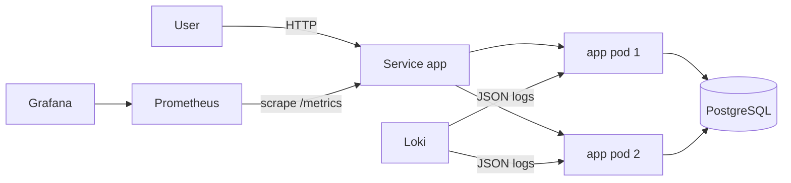

# ST2DCE Project - DevOps end-to-end deliverable

## Status

| #  | Requirement                                                                                         | Pts | State               |
| -- | --------------------------------------------------------------------------------------------------- | --- | ------------------- |
| R1 | Git and collaboration (branching, reviewed PRs, no secrets)                                         | 2   | Yuhao just finished |
| R2 | CI/CD (build, tests, lint, security scan, immutable tag, automated deploy)                          | 4   | doing               |
| R3 | Containerization (multi-stage or minimal base, non-root, pinned, .dockerignore)                     | 1   | doing               |
| R4 | Kubernetes (Deployment, Service, ConfigMap, Secret, probes, resources, 2+ replicas, rolling update) | 3   |                |
| R5 | IaC (Terraform in `infra/`, variables/outputs/state, plan in pipeline, ephemeral env)               | 3   |                |
| R6 | Observability (metrics, dashboard, 2 alerts, SLO, centralized logs)                                 | 3   |                |
| R7 | Incident and postmortem (fault injection, timeline, 5 Whys, runbook, actions)                       | 3   |                |
| R8 | Documentation (README rebuilds the project from scratch)                                            | 1   |                |

## Architecture

 

## Team

| Member (GitHub)                                  | Role                                    |
| ------------------------------------------------ | --------------------------------------- |
| @JackyHuang75414                                 | CI/CD and container                     |
| @chealeanpenhchakrith                            | Kubernetes and Terraform                |
| @Djalli94                                        | Observability                           |
| _@_[yinghui-ren](https://github.com/yinghui-ren) | Application, incident and documentation |

Individual contribution statements are submitted separately.
