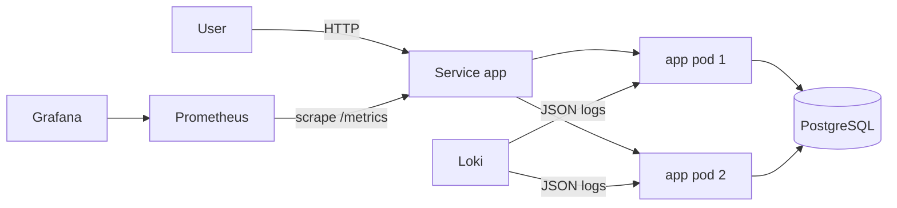

# ST2DCE Project - DevOps end-to-end deliverable

Small REST API + PostgreSQL, packaged in a container, deployed on Kubernetes with
Terraform-provisioned infrastructure, monitored with Prometheus/Grafana and Loki,
and operated through a documented incident.

> **Deadline: 30 November 2026.** Everything must be on `main` at the deadline.
> Submission = this repository URL + a 5-8 minute demo video + individual
> contribution statements + GenAI usage declaration.

## Status (requirements from the project brief)

| # | Requirement | Pts | State |
|---|---|---|---|
| R1 | Git and collaboration (branching, reviewed PRs, no secrets) | 2 | :construction: branch protection to enable, conventions below |
| R2 | CI/CD (build, tests, lint, security scan, immutable tag, automated deploy) | 4 | :white_check_mark: build/test/lint/Trivy/gitleaks + GHCR push wired; **deploy job TODO** |
| R3 | Containerization (multi-stage or minimal base, non-root, pinned, .dockerignore) | 1 | :white_check_mark: `Dockerfile` |
| R4 | Kubernetes (Deployment, Service, ConfigMap, Secret, probes, resources, 2+ replicas, rolling update) | 3 | :x: `k8s/` TODO |
| R5 | IaC (Terraform in `infra/`, variables/outputs/state, plan in pipeline, ephemeral env) | 3 | :x: `infra/` TODO |
| R6 | Observability (metrics, dashboard, 2 alerts, SLO, centralized logs) | 3 | :construction: app already exposes `/metrics` + JSON logs; stack TODO |
| R7 | Incident and postmortem (fault injection, timeline, 5 Whys, runbook, actions) | 3 | :x: drill TODO |
| R8 | Documentation (README rebuilds the project from scratch) | 1 | :construction: this file |

## Architecture



Details and design decisions: [`docs/architecture.md`](docs/architecture.md).

## Repository layout

```
app/                 Node.js 20 + Express application (source, tests, lint)
Dockerfile           multi-stage image, non-root, pinned base
k8s/                 Kubernetes manifests / Kustomize overlays
infra/               Terraform code (cluster resources, namespace, ephemeral env)
monitoring/          Prometheus rules, Grafana dashboard JSON, Loki config
docs/                architecture, runbook, incident timeline, postmortem
.github/workflows/   CI/CD pipeline
```

## Prerequisites

- Docker Desktop (Linux containers), at least 4 GB of RAM for the monitoring stack
- Node.js 20+ and npm
- `kubectl`, `kind`, `helm`, `terraform` (>= 1.6)

## Run locally

```bash
cd app
npm ci
npm test
npm run lint
node server.js          # http://localhost:3000
```

Useful endpoints: `/health` (probe target), `/metrics` (Prometheus), `/slow`
(random latency, for dashboards), `/error` (30 % HTTP 500, for alerts).

## Build and run the container

```bash
docker build -t app:local .
docker run -d --rm -p 3000:3000 --name app app:local
curl http://localhost:3000/health
```

## Deploy to Kubernetes (kind)

> TODO (owner: ___) - fill in once `k8s/` and `infra/` are written:
> create the cluster, apply the manifests (or `terraform apply`), wait for the
> rollout, then reach the application.

```bash
kind create cluster --name st2dce
# kubectl apply -k k8s/overlays/dev
# kubectl rollout status deployment/app -n dev
# kubectl port-forward svc/app 8080:80 -n dev
```

## Destroy everything

```bash
# kubectl delete -k k8s/overlays/dev
# terraform -chdir=infra/envs/dev destroy
kind delete cluster --name st2dce
```

## Team

| Member (GitHub) | Role |
|---|---|
| @JackyHuang75414 | CI/CD and container |
| @chealeanpenhchakrith | Kubernetes and Terraform |
| @Djalli94 | Observability |
| _(4th member)_ | Application, incident and documentation |

Individual contribution statements are submitted separately.

## GenAI usage declaration

Tools used and their purpose are declared in the submission document. All generated
content was reviewed and is understood by the team.
